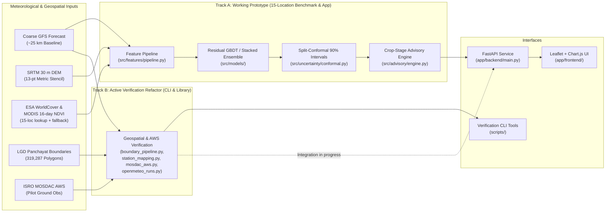
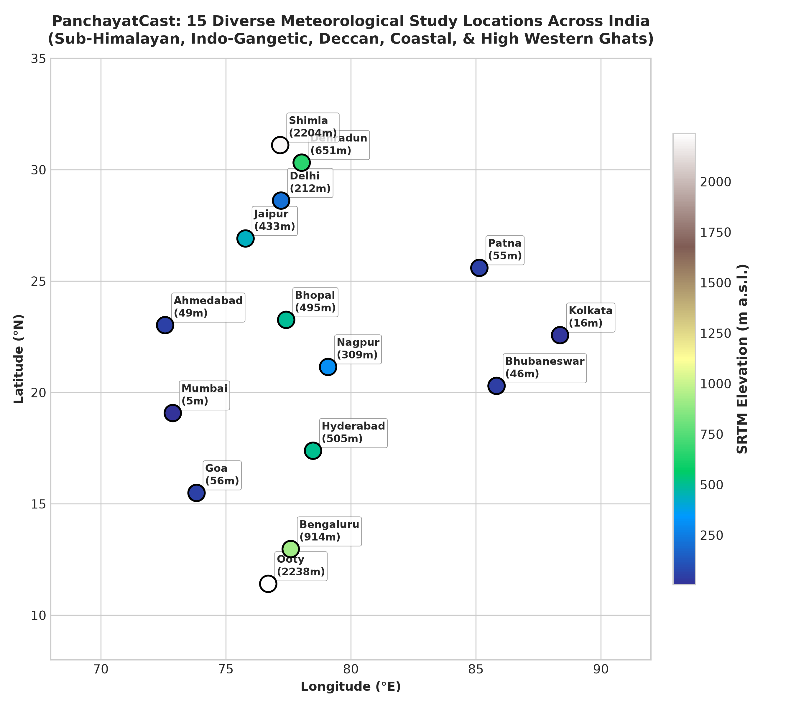
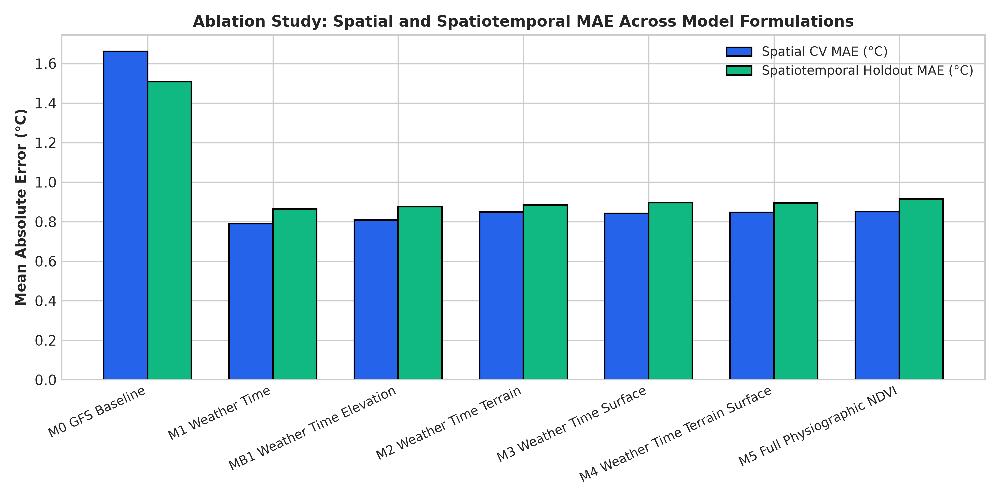
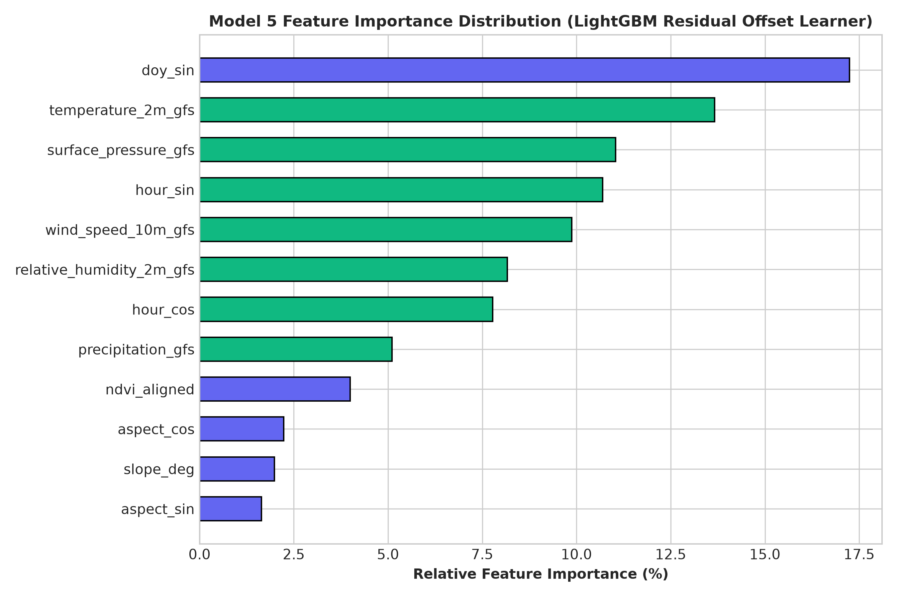
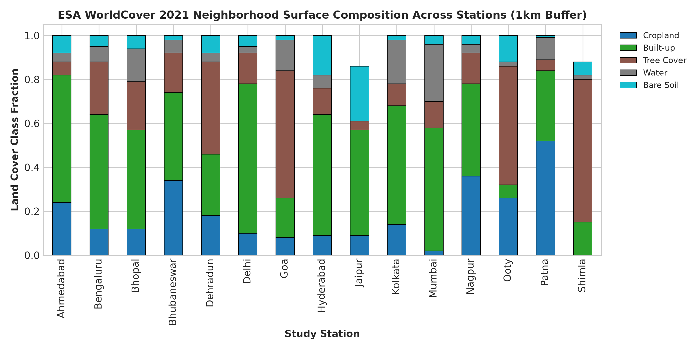

# PanchayatCast — Sub-Grid Weather Downscaling & Agro-Advisory System

**Project Status:** Active Development (Work in Progress)  
**Domain:** Weather Intelligence, Disaster Management & Agro-Meteorology • **Author & Maintainer:** [Md Saami](https://github.com/mdsaami)

PanchayatCast is an evolving weather intelligence platform focused on translating broader-scale weather forecasts (~25 km resolution) into more locally relevant insights for Panchayat-level decision-making (1–5 $\text{km}^2$) in India.

The repository currently contains a working 15-location research prototype and web dashboard alongside an active data-engineering refactor that is transitioning the pipeline from reanalysis proxies (`ERA5-Land`) and point coordinates to nationwide Gram Panchayat boundary polygons (`319,287` records), fixed-initialization forecast runs, and ground-level ISRO MOSDAC Automatic Weather Station (AWS) observations.

---

## 1. Technical Motivation and Real-World Context

Public weather forecasts and agricultural advisories in India are typically issued at the district or administrative block (Tehsil/Mandal) level, driven by global or regional NWP models operating on 12–25 km grid cells (150–625 $\text{km}^2$ per pixel). A single administrative block in India contains 20 to 60 Gram Panchayats.

When a single coarse grid value is broadcast across an entire block, sub-grid topography and land-surface variations are averaged out. In regions with complex terrain—such as the Himalayan foothills (Uttarakhand, Himachal Pradesh), the Western Ghats escarpment (Maharashtra, Karnataka, Kerala), and plateau scarps—elevation can change by 500 to 1,500 meters over a 10 km horizontal transect. Applying a valley-floor block forecast to an upland Panchayat leads to systematic temperature errors of 3 °C to 10 °C, causing missed frost warnings, mistimed irrigation schedules, and ineffective chemical spraying windows.

---

## 2. Why Panchayat-Level Forecasting Matters

Gram Panchayats (`226,984` unique LGD administrative units across India) are the primary grass-roots governance and disaster-response units in rural India:
- **Microclimate Variability**: Local lapse rates ($\sim 6.5\text{ }^\circ\text{C/km}$), cold-air drainage in valleys, south- vs. north-facing slope insolation, and evaporative cooling over irrigated cropland create persistent 1–6 °C thermal gradients within a single block.
- **Threshold-Sensitive Crop Decisions**: Agricultural risks are governed by sharp physiological thresholds rather than smooth averages. For example, rice flowering sterility spikes above 35 °C, potato late blight sporulates when high humidity coincides with 12–24 °C temperatures, and pesticide application fails if wind speeds exceed 15 km/h or rainfall occurs within 4 hours.
- **Uncertainty-Aware Early Action**: Local decision-makers need to know not only the point temperature forecast, but also whether the prediction interval crosses a critical crop-stress or hazard threshold.

---

## 3. Technical Approach Under Development

Running full physics-based numerical weather prediction (such as WRF) at a 1 km grid across all of India is computationally expensive for on-demand localized inference. Our engineering approach explores statistical-physical residual downscaling paired with strict geospatial and observational verification:

1. **Residual Downscaling Formulation**: Rather than predicting local temperature from scratch, the model takes the coarse GFS baseline forecast $T_{\text{baseline}}$ (~25 km native GFS dynamical grid, interpolated to query-point elevation by Open-Meteo) and predicts the sub-grid correction residual $\Delta \hat{T}_{\text{ML}}$ toward the reference target (`ERA5-Land` ~9–11 km reanalysis in the 15-location benchmark, transitioning to in-situ AWS stations):
   $$\hat{T}_{\text{refined}}(x, t) = T_{\text{baseline}}(x, t) + f_\theta\big(X_{\text{met}}(t), X_{\text{time}}(t), X_{\text{terrain}}(x), X_{\text{surface}}(x, t)\big)$$
   *Resolution Scope*: The current prototype performs statistical bias-correction and topographic residual refinement at queried coordinates rather than running a 1 km dynamical atmospheric simulation.
2. **Metric Neighborhood Terrain Extraction**: Queries a 13-point metric stencil (center + N/E/S/W at 250 m, 500 m, and 1,000 m radii) from 30 m SRTM elevation data to compute finite-difference slope, aspect ($\sin/\cos$), multi-scale vertical relief, elevation standard deviation, and relative topographic position (`tpi_ratio`).
3. **Uncertainty Quantification**: Implements split-conformal residual calibration (`ConformalPredictor` in `src/uncertainty/conformal.py`) and multi-quantile gradient boosted trees (`q10`, `q50`, `q90` in `src/models/advanced_residual.py`). In the current FastAPI prototype (`app/backend/main.py`), prediction intervals use a static configured half-width of `±1.15 °C` (`2.30 °C` width), while `MultiQuantileResidualModel` provides out-of-fold heteroscedastic intervals (`87.17%` empirical spatial LLO coverage for a nominal 80% `q10`–`q90` band).
4. **Rule-Based Crop Advisory Prototype**: Evaluates refined hourly temperature trajectories and upper/lower confidence bounds against crop-stage thresholds for 6 crop groups (`Rice (Paddy)`, `Wheat`, `Cotton`, `Maize`, `Vegetables (Tomato/Chilli)`, `Grapes`) across 4 operational categories (chemical spraying, thermal risk, fungal/pest risk, and irrigation demand).
5. **Geospatial & Ground-Station Verification Pipeline (In Progress)**: Normalizes 319,287 LGD Gram Panchayat polygons with true `WGS84` geodesic areas, enforces fixed-run NWP forecast initialization semantics (`lead_hours`), and audits ISRO MOSDAC AWS ground observations with explicit coordinate-uncertainty guardrails.

---

## 4. Development Status

Because PanchayatCast is under active development, the codebase currently spans two stages of implementation that are not yet fully unified into a single end-to-end pipeline. Below is the exact status of every component based on the repository:

### 4.1 Implemented and Working
- **15-Location Benchmark & Residual ML Pipeline (`src/models/`, `src/features/`, `experiments/`)**:
  - Data ingestion and local JSON caching for 15 study locations (`D01` Dehradun to `D15` Ooty, `11,160` hourly observations for August 2024) in [`src/data/fetch_weather.py`](src/data/fetch_weather.py) and [`src/data/dataset.py`](src/data/dataset.py).
  - 13-point metric SRTM terrain feature extractor in [`src/terrain/srtm_extractor.py`](src/terrain/srtm_extractor.py).
  - Residual GBDT models (`LightGBM`, `HistGBDT`, `RandomForest`), `StackedResidualEnsemble`, and `MultiQuantileResidualModel` in [`src/models/residual_model.py`](src/models/residual_model.py) and [`src/models/advanced_residual.py`](src/models/advanced_residual.py).
  - 5-fold Leave-Location-Out (LLO) spatial cross-validation and chronological split evaluators in [`src/validation/`](src/validation/).
  - Split-conformal interval calibration (`90%` coverage) in [`src/uncertainty/conformal.py`](src/uncertainty/conformal.py).
- **Prototype Web Dashboard & FastAPI Service (`app/`)**:
  - FastAPI backend ([`app/backend/main.py`](app/backend/main.py)) exposing `/health`, `/api/locations`, `/api/downscale`, and `/api/transect`.
  - Interactive Leaflet + Chart.js frontend ([`app/frontend/`](app/frontend/)) displaying station markers, hourly forecast + 90% confidence band charts, physiographic readout, and crop advisory cards.
- **Standalone Geospatial & AWS Verification Modules (`src/data/`, `scripts/`, `tests/`)**:
  - Nationwide LGD Gram Panchayat boundary ingestion, `WGS84` geodesic area calculation, and point-in-polygon CLI lookup ([`src/data/boundary_pipeline.py`](src/data/boundary_pipeline.py), [`scripts/build_boundary_dataset.py`](scripts/build_boundary_dataset.py), [`scripts/find_panchayat.py`](scripts/find_panchayat.py)).
  - Canonical forecast schema validation and fixed-initialization Open-Meteo single-run normalization ([`src/data/schema.py`](src/data/schema.py), [`src/data/canonical.py`](src/data/canonical.py), [`src/data/openmeteo_runs.py`](src/data/openmeteo_runs.py)).
  - ISRO MOSDAC AWS file parser, physical range QC flagger, and `merge_asof` temporal aligner ([`src/data/mosdac_aws.py`](src/data/mosdac_aws.py), [`scripts/process_mosdac.py`](scripts/process_mosdac.py)).
  - Spatial station-to-Panchayat validator checking polygon containment, geodesic boundary distance, and coordinate rounding uncertainty ([`src/data/station_mapping.py`](src/data/station_mapping.py), [`scripts/validate_station_mapping.py`](scripts/validate_station_mapping.py)).
  - `75` passing unit and integration tests across 10 test modules in [`tests/`](tests/).

### 4.2 Partially Implemented
- **Land-Cover and NDVI Feature Extraction (`src/surface/landcover.py`, `src/surface/ndvi_processor.py`)**:
  - Pre-extracted ESA WorldCover 2021 fractions and August 2024 MODIS 16-day NDVI profiles are hardcoded in lookup dictionaries for the 15 benchmark locations (`D01`–`D15`).
  - For any custom coordinate clicked on the map (`loc_id="custom"`), the pipeline falls back to a static default agricultural profile (`cropland_fraction=0.65`, `ndvi=0.48–0.58`) rather than querying actual raster tiles or Panchayat polygon statistics.
- **Topographic Transect Endpoint (`GET /api/transect` in `app/backend/main.py`)**:
  - Returns static, pre-computed transect arrays for two demonstration regions (`dehradun_mussoorie` and `pune_ghats`) rather than computing dynamic transects along user-drawn map lines.
- **Conformal Margin in Backend Inference (`app/backend/main.py`)**:
  - Uses the pre-calibrated scalar margin `q_val = 1.15 °C` from the August 2024 calibration split rather than dynamically recalibrating per forecast lead time or using `MultiQuantileResidualModel` in the API response.
- **Ground Station Verification Benchmark (`scripts/run_historical_benchmark.py`)**:
  - The temporal alignment and metric calculation code is implemented and tested on synthetic fixtures, but only one real pilot MOSDAC AWS file (`IMDE1401_141579` in Pusa, Bihar, covering 168 hours in Nov 2013) is currently in the repository. Because its metadata coordinates (`25.98, 85.67`) are rounded to 2 decimal places (`~748.4 m` uncertainty radius vs. `44.26 m` distance to the Mohmadpur Deopar Panchayat border), the spatial validator rejects the mapping (`validation_status = "rejected_coordinate_uncertainty"`), leaving `reports/benchmark_metrics_station.json` with an empty approved benchmark list until higher-precision station coordinates are sourced.

### 4.3 Currently Under Development
- **Bridging the Boundary Pipeline and Live Inference**: Connecting [`src/data/boundary_pipeline.py`](src/data/boundary_pipeline.py) and [`scripts/find_panchayat.py`](scripts/find_panchayat.py) to `POST /api/downscale` so clicking a coordinate on the web dashboard resolves the exact Gram Panchayat name, LGD `panchayat_id`, `block_id`, and polygon geometry.
- **Resolving Sub-Grid $\Delta z$ in Training Data**: In the current 15-location dataset (`data/processed/unified_dataset_2024-08-01_2024-08-31.csv`), Open-Meteo's `gfs_seamless` endpoint returns a 90 m DEM-interpolated grid elevation equal to `elevation_local`, resulting in `elevation_diff == 0.0` across all rows. We are refactoring the ingestion pipeline toward [`src/data/openmeteo_runs.py`](src/data/openmeteo_runs.py) and native $0.25^\circ$ grid-cell elevation calculation to restore true sub-grid $\Delta z$.
- **Transitioning Feature Pipelines to Canonical Schema**: Updating all training and inference scripts to consume the canonical column contract (`baseline_temperature`, `target_temperature`, `forecast_init_time`, `valid_time`, `lead_hours`) defined in [`src/data/schema.py`](src/data/schema.py).

### 4.4 Planned Future Features (Not Yet Implemented)
- **Trained Deep Learning Downscaler (`src/models/bc_unet.py`)**: Currently, `BCUnetDownscaler` is only a lightweight NumPy architectural stub using random initialized weights and a `-0.0065 °C/m` lapse rate. Implementing a real spatial patch CNN/UNet in PyTorch is a future exploration topic.
- **Panchayat-Level Zonal Statistics**: Pre-computing ESA WorldCover and DEM terrain aggregates for all `319,287` LGD Panchayat polygons so any Panchayat query uses real polygon-averaged surface properties.
- **Multi-Variable Downscaling**: Extending residual post-processing beyond 2 m temperature to 10 m wind speed, relative humidity, and quantitative precipitation.
- **LLM / Claude Tool-Use Layer**: Building a grounded natural-language interface on top of the deterministic Python outputs for multilingual village advisories (see [`docs/CLAUDE_DEVELOPER_PROGRAM.md`](docs/CLAUDE_DEVELOPER_PROGRAM.md)).

---

## 5. System Architecture

The diagram below illustrates how the implemented 15-location prototype (Track A) and the ongoing geospatial/AWS verification refactor (Track B) are currently organized in the repository:



See [`docs/ARCHITECTURE.md`](docs/ARCHITECTURE.md) for sequence diagrams and module details.

---

## 6. Actual Technology Stack

| Layer | Technologies Used |
| :--- | :--- |
| **Language & Runtime** | Python 3.11+ |
| **Machine Learning** | `lightgbm`, `scikit-learn` (`HistGradientBoostingRegressor`, `RandomForestRegressor`, `Ridge`), `scipy`, `numpy`, `joblib` |
| **Data & Geospatial** | `pandas`, `pyarrow` (Parquet), `geopandas`, `shapely`, `pyproj` (`WGS84` ellipsoid geodesics), `pyogrio` |
| **Backend API** | `fastapi`, `uvicorn`, `pydantic`, `requests`, `pyyaml` |
| **Frontend Dashboard** | Vanilla HTML5 / CSS3 / ES6 JavaScript, `Leaflet.js` (1.9.4), `Chart.js` (4.4.0) |
| **Testing & Visualization** | `pytest` (75 unit and integration tests), `matplotlib`, `seaborn` |

---

## 7. Data Sources and Processing Pipeline

1. **Coarse Forecast Baseline**: Hourly 2 m temperature, relative humidity, surface pressure, 10 m wind speed, and precipitation from the Open-Meteo Historical Forecast API (`gfs_seamless`, ~25 km) and Single-Runs API (`gfs_global` with explicit `forecast_init_time` and `lead_hours`).
2. **Reanalysis Target (Used in 15-Location Prototype)**: Hourly 2 m temperature from `ERA5-Land` (~9–11 km) via the Open-Meteo Archive API across 15 Indian locations (`D01` Dehradun to `D15` Ooty, 5 m to 2,238 m elevation) for August 1–31, 2024 (`11,160` station-hours). Note that `ERA5-Land` is a gridded reanalysis proxy used while ground AWS coverage is being expanded.
3. **Terrain Derivatives**: 30 m SRTM elevation queried via a 13-point metric stencil (`src/terrain/srtm_extractor.py`) to compute local slope (`slope_deg`), aspect (`aspect_sin`, `aspect_cos`), relief within 500 m and 1,000 m (`relief_500m`, `relief_1000m`), elevation standard deviation (`elev_std_1000m`), and topographic position ratio (`tpi_ratio`).
4. **Land Cover & Phenology**: Pre-extracted 1 km ESA WorldCover 2021 fractions and 16-day MODIS `MOD13Q1` NDVI values for the 15 study stations (`src/surface/`).
5. **Nationwide Gram Panchayat Polygons**: `319,287` polygon rows (`226,984` unique LGD Panchayat codes across 28 States/UTs) normalized in `src/data/boundary_pipeline.py` with `WGS84` geodesic area computation (correcting a `+24.2%` Web Mercator `SHAPE_Area` inflation in the raw source data).
6. **ISRO MOSDAC AWS Ground Observations**: Hourly ground station records audited in `src/data/mosdac_aws.py` (tested on `168` hourly observations from pilot station `IMDE1401_141579(PUSA_BH_AGRO)` in Samastipur, Bihar), with automated physical range QC and timestamp deduplication.

Full provenance details, schema contracts, and dataset limitations are documented in [`docs/DATA_SOURCES.md`](docs/DATA_SOURCES.md).

---

## 8. Machine Learning Methodology and Preliminary Results

### 8.1 Validation Protocol
Evaluating spatial downscaling models with random train/test splits leaks station-specific static features across adjacent hours. We evaluate models on the 15-location August 2024 dataset under two protocols (`experiments/run_ablation_study.py`, `experiments/run_reproduce_15loc.py`):
- **5-Fold Leave-Location-Out (LLO) Spatial Cross-Validation**: `GroupKFold(n_splits=5)` grouped by `location_id` (12 training stations, 3 unseen test stations per fold).
- **Chronological Forecast Split**: Train on August 1–22, 2024 (`528` hours/station); evaluate on August 23–31, 2024 (`216` hours/station).

### 8.2 Feature Ablation Results (`results/metrics/ablation_study_summary.csv` & `new_architecture_benchmark.csv`)

| Model Configuration | Feature Count | Spatial LLO CV MAE (°C) | Spatial LLO CV RMSE (°C) | Temporal Split MAE (°C) | Spatiotemporal MAE (°C) |
| :--- | :---: | :---: | :---: | :---: | :---: |
| `Model_0_GFS_Baseline` (Raw GFS) | — | `1.6614 ± 0.4529` | `2.1922 ± 0.5625` | `1.5078` | `1.5078` |
| `Model_1_Weather_Time` (Met + Cyclical Time) | 9 | **`0.7907 ± 0.0352`** | **`1.0347 ± 0.0437`** | `0.7695` | **`0.8649`** |
| `Model_B1_Weather_Time_Elevation` | 10 | `0.8080 ± 0.0332` | `1.0527 ± 0.0454` | `0.7524` | `0.8760` |
| `Model_2_Weather_Time_Terrain` | 17 | `0.8483 ± 0.0843` | `1.1004 ± 0.0965` | `0.7489` | `0.8841` |
| `Model_3_Weather_Time_Surface` | 14 | `0.8426 ± 0.1034` | `1.1039 ± 0.1268` | **`0.7388`** | `0.8966` |
| `Model_4_Weather_Time_Terrain_Surface` | 22 | `0.8481 ± 0.1116` | `1.1110 ± 0.1397` | `0.7460` | `0.8948` |
| `Model_5_Full_Physiographic_NDVI` | 23 | `0.8511 ± 0.1149` | `1.1131 ± 0.1460` | `0.7609` | `0.9141` |
| `Model_6_Physical_Terrain` (LightGBM) | 13 | `0.8154 ± 0.0694` | `1.0674 ± 0.0798` | — | — |
| `NewArch_Stacked_Ensemble` (`Model_6` features) | 13 | `0.8113 ± 0.0567` | `1.0619 ± 0.0641` | — | — |
| `NewArch_Multi_Quantile` (`q50` median, `87.17%` `q10`–`q90` cov.) | 13 | `0.8477 ± 0.0754` | `1.1017 ± 0.0987` | — | — |

### 8.3 Algorithm Comparison under Spatial LLO CV (`results/metrics/algorithm_comparison.csv`)

> *Note: In `experiments/run_benchmark.py`, the multi-algorithm comparison below was evaluated using the 23-feature `Model_5_Full_Physiographic_NDVI` feature set across all ML estimators.*

| Algorithm | Spatial LLO CV MAE (°C) | Spatial LLO CV RMSE (°C) | Mean Fold Reduction (%) |
| :--- | :---: | :---: | :---: |
| `Raw_GFS_Baseline` | `1.6614 ± 0.4529` | `2.1922 ± 0.5625` | `0.00%` |
| `Mean_Bias_Correction` | `1.5948 ± 0.3712` | `2.0846 ± 0.4398` | `+3.99%` |
| `Lapse_Rate_Correction` (`elevation_diff == 0.0`) | `1.6614 ± 0.4529` | `2.1922 ± 0.5625` | `0.00%` |
| `Ridge_Regression` (`Model_5` features) | `0.9222 ± 0.1710` | `1.1790 ± 0.2143` | `+43.47%` |
| `HistGradientBoosting` (`Model_5` features) | `0.8620 ± 0.1167` | `1.1322 ± 0.1461` | `+46.16%` |
| `LightGBM` (`Model_5` features) | `0.8511 ± 0.1149` | `1.1131 ± 0.1460` | `+46.84%` |
| `Random_Forest` (`Model_5` features) | `0.8380 ± 0.1072` | `1.1030 ± 0.1353` | `+47.62%` |
| `LightGBM` (`Model_1` Met + Time features) | **`0.7907 ± 0.0352`** | **`1.0347 ± 0.0437`** | **`+52.41%` overall (`+47.25%` fold mean)** |

**What We Learned From the Ablation Study**: Adding static site attributes (`Model_B1` and `Model_2`–`Model_5`) reduced error on chronological splits for known stations (`0.7388 °C` MAE), but degraded spatial generalization on unseen locations (`0.8511 °C` vs. `0.7907 °C` for `Model_1`). With only 12 training locations per fold, tree models split on exact static elevation/land-cover values to memorize station biases—and because Open-Meteo's `gfs_seamless` API pre-interpolated grid elevation to the local DEM, `elevation_diff` was `0.0` across the dataset (`feature_importances_model5.csv`). Introducing scale-free relative topographic ratios (`tpi_ratio`) and a Ridge-stacked ensemble (`Model_6_Physical_Terrain` at `0.8154 °C` MAE and `NewArch_Stacked_Ensemble` at `0.8113 °C` MAE) partially mitigated this overfitting, motivating our ongoing work to expand the station count and compute true coarse-grid elevation offsets. See [`docs/TECHNICAL_DECISIONS.md`](docs/TECHNICAL_DECISIONS.md) for full details.

---

## 9. Repository Structure

```text
├── app/
│   ├── backend/
│   │   └── main.py                      # FastAPI prototype service (/health, /api/locations, /api/downscale, /api/transect)
│   └── frontend/
│       ├── index.html                   # Single-page dashboard layout
│       ├── app.js                       # Leaflet map, Chart.js plots, and API client
│       └── styles.css                   # Responsive styling
├── config/
│   ├── default.yaml                     # Study parameters, model hyperparameters, and feature settings
│   ├── locations.json                   # Metadata and coordinates for the 15 benchmark locations (D01-D15)
│   └── station_panchayat_mapping.csv    # Candidate AWS-to-Panchayat mapping registry with validation status
├── data/
│   ├── raw/                             # Cached Open-Meteo GFS, ERA5-Land, SRTM JSONs & MOSDAC pilot data
│   ├── interim/                         # Intermediate AWS benchmark parquet files
│   └── processed/                       # Unified 15-location dataset (11,160 rows), normalized MOSDAC CSV, lookup table
├── docs/
│   ├── ARCHITECTURE.md                  # System architecture, track separation, and data flow diagrams
│   ├── SETUP.md                         # Local installation, CLI usage, and troubleshooting guide
│   ├── DATA_SOURCES.md                  # Data provenance, resolutions, and schema contracts
│   ├── TECHNICAL_DECISIONS.md           # Engineering trade-offs, ablation findings, and verification design
│   └── CLAUDE_DEVELOPER_PROGRAM.md      # Development challenges, milestones, and Claude integration roadmap
├── experiments/
│   ├── run_ablation_study.py            # 5-fold spatial LLO & temporal split ablation (Models 0-5)
│   ├── run_benchmark.py                 # Multi-algorithm comparison benchmark
│   ├── run_reproduce_15loc.py           # Model 6 physical terrain & quantile reproduction benchmark
│   ├── run_new_architecture_benchmark.py# Stacked ensemble & quantile coverage benchmark
│   └── generate_visualizations.py       # Generates diagnostic plots in results/figures/
├── models/
│   └── final_residual_model_lightgbm.joblib # Serialized LightGBM residual model (trained on Model_5 features)
├── reports/                             # Internal engineering audit reports & JSON validation outputs
├── results/
│   ├── figures/                         # 9 empirical evaluation plots (01-06, 11-13)
│   └── metrics/                         # Benchmark CSV outputs
├── scripts/
│   ├── build_boundary_dataset.py        # Normalizes nationwide LGD Panchayat boundaries
│   ├── find_panchayat.py                # CLI point-in-polygon Gram Panchayat lookup
│   ├── inspect_boundaries.py            # Audits LGD boundary quality & Web Mercator area distortion
│   ├── prefetch_data.py                 # Fetches/builds the 15-location dataset
│   ├── process_mosdac.py                # Normalizes MOSDAC AWS exports and generates QC report
│   ├── run_historical_benchmark.py      # Aligns fixed-run forecasts with AWS observations
│   └── validate_station_mapping.py      # Validates station-to-Panchayat containment & rounding uncertainty
├── src/
│   ├── advisory/engine.py               # Crop-stage risk rule engine
│   ├── data/                            # Ingestion, canonical schema, boundary pipeline, MOSDAC QC, station mapping
│   ├── features/pipeline.py             # Cyclical time, physical terrain features, and FEATURE_SETS
│   ├── models/                          # Residual GBDT, stacked ensemble, quantile models, baselines, bc_unet stub
│   ├── surface/                         # ESA WorldCover fractions and MODIS 16-day NDVI interpolation
│   ├── terrain/srtm_extractor.py        # 13-point metric neighborhood SRTM extractor
│   ├── uncertainty/                     # Split-conformal predictor and quantile GBDT wrapper
│   └── validation/                      # Spatial LLO CV, chronological CV, and spatiotemporal diagnostics
├── tests/                               # 10 pytest modules (75 unit and integration tests)
├── .env.example                         # Environment variable template
├── .gitignore                           # Git ignore rules (excludes >100 MB GeoParquet files and caches)
└── requirements.txt                     # Python package dependencies
```

---

## 10. Installation and Local Setup

### Prerequisites
- Python `3.11` or `3.12`
- `pip`

### Step-by-Step Setup

```bash
# 1. Create and activate a virtual environment
python -m venv .venv

# Windows (PowerShell):
.\.venv\Scripts\Activate.ps1
# Linux / macOS:
# source .venv/bin/activate

# 2. Install dependencies
pip install --upgrade pip
pip install -r requirements.txt
```

---

## 11. Configuration and Environment Variables

The prototype runs locally using cached data in `data/raw/` and public Open-Meteo endpoints without requiring external API keys. Optional overrides can be configured by copying `.env.example` to `.env`:

| Variable | Default | Purpose |
| :--- | :--- | :--- |
| `PANCHAYATCAST_LOCATIONS_PATH` | `config/locations.json` | Path to the 15-location benchmark registry |
| `PANCHAYATCAST_MODEL_PATH` | `models/final_residual_model_lightgbm.joblib` | Path to serialized residual model artifact |
| `PANCHAYATCAST_CONFORMAL_Q` | `1.15` | Calibrated 90% split-conformal residual half-width (°C) |
| `CORS_ORIGINS` | `*` | Comma-separated allowed CORS origins for the FastAPI server |

---

## 12. How to Run the Project

### 12.1 Launch the Prototype Web Dashboard & API
```bash
uvicorn app.backend.main:app --host 127.0.0.1 --port 8000 --reload
```
Open `http://127.0.0.1:8000/` in your browser. Select any of the 15 study stations from the dropdown (or click on the map), choose a crop and growth stage, and click **Run Downscaling**.

### 12.2 Run the Test Suite
```bash
pytest tests/ -v
```
Runs all **75 unit and integration tests** across the 10 test modules in `tests/`.

### 12.3 Run Experiments & Verification CLI Scripts
```bash
# Run the 5-fold spatial & temporal ablation study (Models 0-5)
python experiments/run_ablation_study.py

# Run the Model 6 physical terrain & stacked ensemble reproduction
python experiments/run_reproduce_15loc.py

# Regenerate the 9 empirical evaluation plots in results/figures/
python experiments/generate_visualizations.py

# Validate AWS station-to-Panchayat spatial containment and coordinate precision
python scripts/validate_station_mapping.py

# Normalize ISRO MOSDAC AWS observations and generate quality report
python scripts/process_mosdac.py
```

---

## 13. Visual Results and Screenshots

### Empirical Evaluation Plots (`results/figures/`)

| 15 Study Locations & SRTM Elevations | Ablation Study MAE (Spatial, Temporal, Spatiotemporal) |
| :---: | :---: |
|  |  |
| **Feature Importance (`Model_5`)** | **ESA WorldCover 1 km Surface Fractions** |
|  |  |

Additional empirical figures in [`results/figures/`](results/figures/) include:
- [`02_elevation_distribution.png`](results/figures/02_elevation_distribution.png) — Station elevation transect (`5 m` Kolkata to `2,238 m` Ooty).
- [`04_gfs_vs_refined_rmse.png`](results/figures/04_gfs_vs_refined_rmse.png) — Spatial and spatiotemporal RMSE across model formulations (`Model_0` to `Model_5`).
- [`05_foldwise_spatial_cv.png`](results/figures/05_foldwise_spatial_cv.png) — Fold-by-fold Leave-Location-Out spatial CV comparison (`Model_0`, `Model_1`, `Model_B1`), showing that adding raw point elevation (`Model_B1`) worsens MAE across all 5 of 5 unseen spatial folds (`historical_reproduction_folds.csv`).
- [`12_ndvi_temporal_profiles.png`](results/figures/12_ndvi_temporal_profiles.png) — MODIS `MOD13Q1` 16-day aligned NDVI trajectories across representative study locations.
- [`13_panchayat_advisory_dashboard_sample.png`](results/figures/13_panchayat_advisory_dashboard_sample.png) — Schematic card showing how downscaled forecast bounds map into crop-stage advisories.

> **Note on Excluded Synthetic Plots (`07`–`10`)**: Four illustrative helper functions in [`experiments/generate_visualizations.py`](experiments/generate_visualizations.py) (`07_predicted_vs_reference_temperature.png`, `08_residual_distribution.png`, `09_uncertainty_conformal_intervals.png`, and `10_topographic_transect.png`) use placeholder/synthetic formulas rather than saved out-of-fold LightGBM predictions. They have been disabled in `generate_visualizations.py`, moved out of `results/figures/`, and excluded via `.gitignore` so only genuine empirical figures (`01`–`06`, `11`–`13`) are included in the repository.

### Prototype Dashboard Screenshots (Manual Capture Guide)
To capture screenshots of the current web interface, start the server (`uvicorn app.backend.main:app --port 8000`) and save the following views into `docs/screenshots/`:
1. **Main Dashboard View (`dashboard_overview.png`)**: Default view at `http://127.0.0.1:8000/` showing the Leaflet map with the 15 study markers, KPI cards, and 36-hour temperature chart.
2. **High-Elevation Station View (`shimla_or_ooty_downscale.png`)**: Select `D02 — Shimla (2204m)` or `D15 — Ooty (2238m)` with `Vegetables (Tomato/Chilli)` or `Rice (Paddy)` to show the sub-grid correction, `±1.15 °C` confidence band, and advisory cards.
3. **Topographic Transect Panel (`dehradun_mussoorie_transect.png`)**: The bottom-right dual-axis chart comparing elevation bars (`640 m` Dehradun ISBT to `2,275 m` Lal Tibba Peak) against illustrative transect temperatures (`31.8 °C` down to `21.1 °C`).

---

## 14. Known Limitations and Open Engineering Challenges

1. **Reanalysis Proxy vs. In-Situ Ground Truth**: The 15-location benchmark trains and evaluates against `ERA5-Land` (~9–11 km reanalysis) rather than physical weather stations. While `src/data/mosdac_aws.py` and `src/data/historical_pipeline.py` now implement the ground-station verification pipeline, we currently have only one 7-day pilot AWS file (`IMDE1401_141579`, Nov 2013) in the repo.
2. **AWS Coordinate Rounding vs. Panchayat Polygon Scale**: In `reports/pilot_station_spatial_validation.json`, the pilot MOSDAC station's coordinates (`25.98°N, 85.67°E`) are reported to only 2 decimal places (`~748.4 m` uncertainty radius), whereas the point lies `44.26 m` from the border of Mohmadpur Deopar Gram Panchayat (`panchayat_id = 100318`), with 15 neighboring Panchayats intersecting the uncertainty circle. Sourcing 4-decimal-place station metadata (`~7.5 m` precision) is necessary before station-to-Panchayat joins can be approved.
3. **Zero `elevation_diff` in `gfs_seamless` Cached Data**: Because Open-Meteo's `gfs_seamless` endpoint automatically adjusts grid elevation using a 90 m DEM, `elevation_gfs` equals `elevation_local` in `unified_dataset_2024-08-01_2024-08-31.csv`. Computing the true mean elevation of the coarse $0.25^\circ$ GFS grid cell is needed so `elevation_diff` reflects real sub-grid relief during training.
4. **One-Month Monsoon Window**: The 15-location benchmark dataset covers August 2024 (`744` hours/station). Expanding training across winter inversion, pre-monsoon heatwave, and post-monsoon frost seasons is required for year-round deployment.
5. **Single-Variable Refinement**: Only 2 m temperature is currently downscaled by the ML residual model; precipitation, wind speed, and relative humidity are passed through directly from the coarse GFS baseline to the advisory engine.

---

## 15. Author & Maintainer

- **Md Saami** — Sole Contributor & Repository Owner ([@mdsaami](https://github.com/mdsaami))

---

## 16. Acknowledgements and References

### Data & Infrastructure Providers (Attribution & Licensing)
- **Open-Meteo (`https://open-meteo.com/`)**:
  - *Hosted API Terms (`https://open-meteo.com/en/terms`)*: Offered free of charge for **non-commercial use only**; commercial use of the hosted API requires a paid commercial subscription.
  - *Data Attribution (`https://open-meteo.com/en/license`)*: Weather data (`Historical Forecast`, `Archive`, `Single-Runs`, and `Elevation` APIs) is licensed under **Creative Commons Attribution 4.0 International (`CC BY 4.0`)** (*"Weather data by Open-Meteo.com"*).
  - *Server Software*: Open-Meteo's server source code is licensed under **AGPLv3** (distinct from the API data).
- **Copernicus Climate Change Service (C3S) / ECMWF**: Contains modified Copernicus Climate Change Service information (`ERA5-Land`, 2024).
- **NOAA / NCEP & NASA / USGS**: Underlying Global Forecast System (`GFS`) forecasts and Shuttle Radar Topography Mission (`SRTM`) digital elevation data (U.S. Public Domain).
- **ESA WorldCover & NASA LP DAAC (MODIS)**: `© ESA WorldCover project 2021` (`CC BY 4.0`, contains modified Copernicus Sentinel data) and NASA EOSDIS `MOD13Q1` v061 16-day vegetation indices.
- **ISRO MOSDAC (Meteorological & Oceanographic Satellite Data Archival Centre, SAC/ISRO)**: Automatic Weather Station (AWS) ground observation archives (`IMDE1401_141579` Pusa agro-meteorological pilot dataset). Raw and normalized MOSDAC station data are **excluded from public redistribution** via `.gitignore` in accordance with ISRO MOSDAC data policy.
- **Local Government Directory (LGD), Government of India & Community Mirror**: Nationwide Gram Panchayat administrative boundary dataset (`ramSeraph/indian_admin_boundaries` / DataMeet). Raw GeoParquet files are excluded from Git redistribution via `.gitignore`.
- See [`docs/DATA_SOURCES.md`](docs/DATA_SOURCES.md) Section 6 for complete dataset licensing and redistribution terms.

### Key Scientific References
1. **Statistical & Residual Downscaling**: Maraun, D., & Widmann, M. (2018). *Statistical Downscaling and Bias Correction for Climate Research*. Cambridge University Press.
2. **Spatial Cross-Validation in Environmental Modeling**: Meyer, H., Reudenbach, C., Hengl, T., Katurji, M., & Nauss, T. (2018). Improving performance of spatio-temporal machine learning models using forward feature selection and target-oriented validation. *Environmental Modelling & Software*, 101, 1–9.
3. **Conformal Prediction**: Lei, J., G'Sell, M., Rinaldo, A., Tibshirani, R. J., & Wasserman, L. (2018). Distribution-free predictive inference for regression. *Journal of the American Statistical Association*, 113(523), 1094–1111.
4. **Attention-Based Downscaling**: Woo, S., Park, J., Lee, J.-Y., & Kweon, I. S. (2018). CBAM: Convolutional Block Attention Module. *Proceedings of the European Conference on Computer Vision (ECCV)*.
