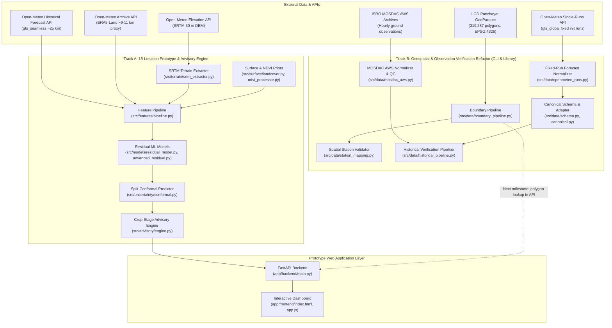
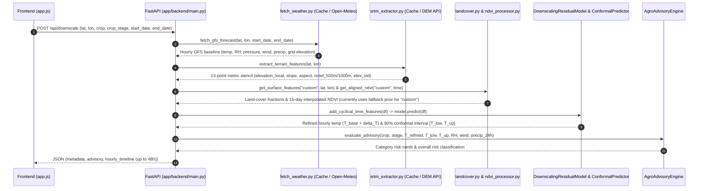
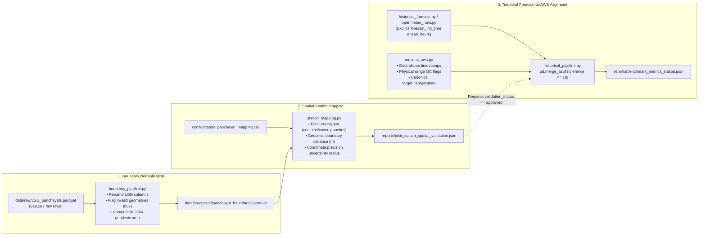

# System Architecture

**Project Status:** Active Development (Work in Progress)

PanchayatCast is an evolving weather intelligence platform focused on translating broader-scale weather forecasts into more locally relevant insights for Panchayat-level decision-making. Because the project is actively evolving, the repository is organized around two complementary engineering tracks:

1. **Track A — Working 15-Location Downscaling Prototype & Web Application**: An end-to-end statistical residual downscaling pipeline, split-conformal uncertainty quantifier, rule-based crop advisory engine, and FastAPI + Leaflet web dashboard evaluated across 15 physiographically diverse benchmark locations in India using `ERA5-Land` reanalysis targets.
2. **Track B — Ongoing Geospatial, Fixed-Run Forecast & Station Verification Refactor**: A modular data-engineering layer built to resolve the methodological limitations discovered during Track A: nationwide Local Government Directory (LGD) Gram Panchayat boundary normalization (`319,287` polygons), fixed-initialization NWP forecast ingestion (`lead_hours` tracking), ISRO MOSDAC Automatic Weather Station (AWS) quality auditing, and spatial station-to-Panchayat mapping validation.

> [!IMPORTANT]
> **Current Integration State**: Track A powers the interactive web dashboard (`app/backend/main.py`) and the 15-location ablation benchmarks (`experiments/`). Track B (`src/data/boundary_pipeline.py`, `src/data/openmeteo_runs.py`, `src/data/mosdac_aws.py`, `src/data/station_mapping.py`, and CLI scripts in `scripts/`) is implemented and unit-tested (`tests/`), and is currently being integrated into the live application to transition the system from reanalysis proxies and point lookups to verified ground-station and polygon-level operation.

---

## 1. High-Level Component Architecture

---

## 2. Prototype Inference Data Flow (`POST /api/downscale`)

When a user selects one of the 15 study stations or clicks an arbitrary coordinate on the Leaflet map, the frontend sends a `POST /api/downscale` request to `app/backend/main.py`. The prototype backend executes a 6-stage synchronous pipeline:

### Runtime Fallbacks & Current Prototype Simplifications
1. **Weather & DEM Caching**: `fetch_weather.py` and `srtm_extractor.py` cache every JSON response in `data/raw/` keyed by coordinates rounded to 4 decimal places (`gfs_{lat}_{lon}_{start}_{end}.json` and `terrain_{lat}_{lon}.json`).
2. **Custom Coordinate Surface Prior**: Notice in step 5 above that `app/backend/main.py` passes `loc_id="custom"` to `get_surface_features` and `get_aligned_ndvi`. While the 15 benchmark datasets use station-specific ESA WorldCover and MODIS NDVI values, live API inference on arbitrary coordinates currently falls back to a default rural agricultural profile (`cropland=0.65`).
3. **Untrained Model Fallback**: In `app/backend/main.py`, if `models/final_residual_model_lightgbm.joblib` does not exist on disk, the endpoint falls back to a deterministic environmental lapse-rate correction ($\Delta T = -0.0065 \times (z_{\text{local}} - z_{\text{GFS}})$).
4. **Frontend Offline Simulation**: In `app/frontend/app.js`, if the backend `/api/downscale` call fails, `renderFallbackSimulation()` synthesizes a 24-hour diurnal curve and lapse-rate adjustment in the browser so UI layout and chart rendering can still be tested offline.

---

## 3. Track B: Geospatial & Station Verification Pipeline (In Progress)

While Track A demonstrates the ML downscaling workflow on 15 locations using reanalysis targets (`ERA5-Land`), evaluating true Panchayat-level skill requires matching NWP forecast runs to physical ground stations and verifying which Gram Panchayat polygon contains each station. Track B implements the foundational modules for this verification architecture:

---

## 4. Module Responsibility & Implementation Status Matrix

| Package / Directory | Key Files | Implementation Status | Responsibility |
| :--- | :--- | :--- | :--- |
| `src/data/` | `fetch_weather.py`, `dataset.py` | **Working (Prototype)** | Fetches and caches Open-Meteo `gfs_seamless` and `era5_land` series; builds the 15-location unified dataset (`11,160` rows). |
| `src/data/` | `schema.py`, `canonical.py` | **Working (Library)** | Defines canonical column contracts (`baseline_temperature`, `target_temperature`, `forecast_init_time`, `valid_time`, `lead_hours`) and adapts legacy GFS/ERA5 column names. |
| `src/data/` | `openmeteo_runs.py`, `historical_forecast.py` | **Working (Library)** | Queries Open-Meteo `single-runs-api` and `historical-forecast-api` with explicit initialization timestamps and provenance hashing. |
| `src/data/` | `boundary_pipeline.py` | **Working (CLI / Library)** | Normalizes nationwide LGD Panchayat boundaries, validates geometries without silent dropping, and computes WGS84 ellipsoid area and representative points via `pyproj.Geod`. |
| `src/data/` | `station_mapping.py` | **Working (CLI / Library)** | Validates candidate AWS station coordinates against Panchayat polygons (`contains`/`covers`/`touches`), computes geodesic distance to boundary, and flags coordinate rounding uncertainty. |
| `src/data/` | `mosdac_aws.py`, `historical_pipeline.py` | **Working (CLI / Pilot Data)** | Parses ISRO MOSDAC hourly `.xls`/HTML/CSV station exports, flags physical sensor outliers, aligns forecasts to observations, and computes station-level MAE/RMSE/Bias. |
| `src/terrain/` | `srtm_extractor.py` | **Working** | Samples a 13-point metric neighborhood (center + N/E/S/W at 250 m, 500 m, 1000 m) via Open-Meteo DEM API to compute finite-difference slope, aspect, relief, and elevation std. |
| `src/surface/` | `landcover.py`, `ndvi_processor.py` | **Partial (15-Loc Lookup + Fallback)** | Provides 1 km surface fractions and 16-day MODIS NDVI profiles for the 15 study stations; uses a static rural fallback prior for custom coordinates. |
| `src/features/` | `pipeline.py` | **Working** | Implements cyclical temporal encoding (`hour_sin/cos`, `doy_sin/cos`), relative topographic position ratios (`tpi_ratio`, `wind_exposure`), and defines `FEATURE_SETS` (`Model_1`–`Model_6`). |
| `src/models/` | `residual_model.py`, `advanced_residual.py`, `baseline.py` | **Working** | Implements `DownscalingResidualModel` (LightGBM, RandomForest, HistGBDT), `MultiQuantileResidualModel`, `StackedResidualEnsemble`, and statistical baselines. |
| `src/models/` | `bc_unet.py` | **Stub Only** | Lightweight NumPy simulation of CBAM attention weights + `-0.0065 °C/m` lapse rate; not a trained deep learning model. |
| `src/uncertainty/` | `conformal.py`, `quantile_gbdt.py` | **Working** | Implements split-conformal prediction intervals ($1 - \alpha = 90\%$) and quantile GBDT wrappers, plus confidence band categorization (`High` / `Moderate` / `Low`). |
| `src/validation/` | `spatial_cv.py`, `temporal_cv.py`, `spatiotemporal.py` | **Working** | Implements 5-fold Leave-Location-Out (LLO) spatial cross-validation, chronological Day 1–22 / Day 23–31 splits, and regional diurnal bias diagnostics. |
| `src/advisory/` | `engine.py` | **Working (Rule Prototype)** | Evaluates 4 crop-risk rules (chemical spraying wash-off/drift, heat & frost stress, fungal blight humidity window, evaporative irrigation demand) across 6 crops. |
| `app/` | `backend/main.py`, `frontend/*` | **Working (Prototype UI)** | FastAPI service and static single-page dashboard (`POST /api/downscale` uses live model; `GET /api/transect` returns static demonstration transects). |
