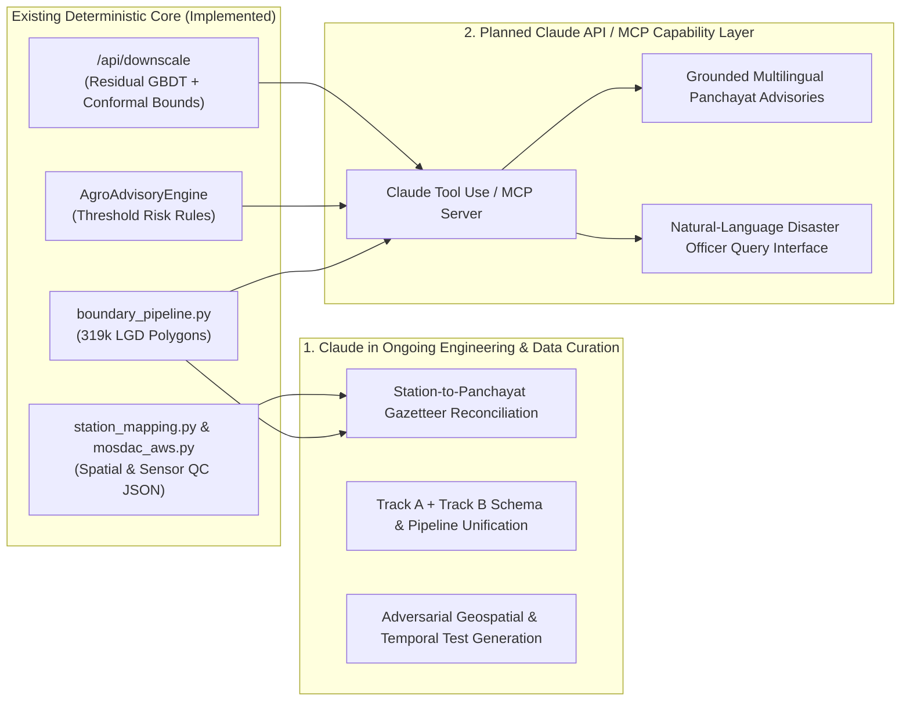

# Claude Developer Program — Engineering Progress, Challenges & Roadmap

- **Project**: PanchayatCast — Sub-Grid Weather Forecast Downscaling & Agro-Advisory System
- **Status**: Active Development (Work in Progress)
- **Domain**: Weather Intelligence, Disaster Management & Agro-Meteorological Decision Support • **Author & Maintainer**: [Md Saami](https://github.com/mdsaami)

> [!NOTE]
> **Implementation Transparency**: PanchayatCast is an ongoing engineering project under active development—an evolving weather intelligence platform focused on translating broader-scale weather forecasts into more locally relevant insights for Panchayat-level decision-making. It is **not** a finished or production-deployed product, and it does **not** currently integrate the Anthropic / Claude API at runtime. All implemented models (`LightGBM`, `StackedResidualEnsemble`), uncertainty intervals (`ConformalPredictor`), geospatial boundary pipelines (`GeoPandas` / `PyProj`), and crop risk checks (`AgroAdvisoryEngine`) run locally in Python. This document outlines the problem we are solving, the technical decisions and roadblocks we have worked through so far, our next engineering milestones, and how Claude can support our continued development.

---

## 1. Real-World Problem Being Addressed

Public weather forecasts and agricultural advisories in India are typically issued at the district or administrative block (Tehsil/Mandal) scale using numerical weather prediction (NWP) grids of 12–25 km resolution (150–625 $\text{km}^2$ per grid cell). However, a single block contains 20 to 60 Gram Panchayats (`226,984` unique LGD Gram Panchayats nationwide), each spanning roughly 1–5 $\text{km}^2$.

Across hilly terrain (Himalayan foothills, Western Ghats, Northeast India), plateau scarps, and coastal-inland transitions, elevation within one block can vary by 500–1,500 meters and surface cover can shift from irrigated paddy fields to rocky slopes or dense forest. Broadcasting a single block-average forecast creates two practical failures:
1. **Systematic Local Thermal Errors**: Valley-floor block forecasts overestimate upland Panchayat temperatures by 3–10 °C, missing localized frost events or triggering false heat-stress alerts.
2. **Untargeted Agricultural Risk Decisions**: Farmers and Panchayat disaster officers make threshold-sensitive decisions—such as whether wind drift and rain allow pesticide spraying over the next 4 hours, or whether nighttime humidity and temperature will trigger potato late blight—that require local microclimate adjustments and explicit uncertainty bounds rather than a single deterministic block number.

---

## 2. Technical Decisions Made So Far

Rather than building a thin UI wrapper around a third-party weather API, we structured the project to investigate the underlying meteorological and geospatial challenges step by step:

1. **Residual Learning Formulation ($\hat{T}_{\text{refined}} = T_{\text{baseline}} + \Delta \hat{T}_{\text{ML}}$)**:
   We train gradient-boosted decision trees (`DownscalingResidualModel` in [`src/models/residual_model.py`](../src/models/residual_model.py)) and stacked ensembles (`StackedResidualEnsemble` in [`src/models/advanced_residual.py`](../src/models/advanced_residual.py)) to predict the local sub-grid residual over the 25 km GFS baseline. This preserves large-scale synoptic skill while bounding the regression target (`mean = -0.35 °C`, `std = 1.48 °C`).
2. **Leave-Location-Out (LLO) Spatial Cross-Validation**:
   Random train/test splits leak static site coordinates across adjacent hours. We implemented 5-fold `GroupKFold` spatial CV grouped by `location_id` ([`src/validation/spatial_cv.py`](../src/validation/spatial_cv.py)) alongside chronological Day 1–22 / Day 23–31 splits ([`src/validation/temporal_cv.py`](../src/validation/temporal_cv.py)) across 15 benchmark locations (`11,160` hourly rows).
3. **13-Point Metric SRTM Terrain Stencil**:
   Instead of relying on point elevation alone, [`src/terrain/srtm_extractor.py`](../src/terrain/srtm_extractor.py) queries a 13-point metric stencil (center + N/E/S/W at 250 m, 500 m, and 1,000 m) to compute finite-difference slope, aspect ($\sin/\cos$), multi-scale relief, and relative topographic position (`tpi_ratio`).
4. **Conformal and Multi-Quantile Uncertainty Propagated into Crop Rules**:
   We implemented split-conformal calibration (`ConformalPredictor` in [`src/uncertainty/conformal.py`](../src/uncertainty/conformal.py), configured with a static `±1.15 °C` margin in the prototype backend) alongside multi-quantile GBDTs (`MultiQuantileResidualModel` in [`src/models/advanced_residual.py`](../src/models/advanced_residual.py), achieving `87.17%` empirical spatial LLO coverage for the `q10`–`q90` interval) and wired the bounds into [`AgroAdvisoryEngine`](../src/advisory/engine.py) so precautionary warnings fire when the upper/lower bound crosses a physiological threshold.

---

## 3. Engineering Challenges Encountered During Development

A central theme of our work has been discovering where simplifying prototype assumptions break down under rigorous testing, and re-engineering the data pipeline in response:

### Challenge 1: The Static Elevation Overfitting Paradox & `gfs_seamless` DEM Interpolation
- **What Happened**: In our 15-location ablation study ([`results/metrics/ablation_study_summary.csv`](../results/metrics/ablation_study_summary.csv)), `Model_1_Weather_Time` (meteorological + cyclical time features) reduced 5-fold spatial LLO MAE by **52.41%** overall (**47.25%** mean fold reduction, from `1.6614 ± 0.4529 °C` to `0.7907 ± 0.0352 °C`). However, when we added static site elevation and land-cover features (`Model_B1` and `Model_2` through `Model_5`), chronological split error improved (`0.7388 °C`–`0.7609 °C` MAE) while **spatial LLO CV degraded** (`0.8080 °C`–`0.8511 °C` MAE).
- **Root Cause**: Inspection of [`results/metrics/feature_importances_model5.csv`](../results/metrics/feature_importances_model5.csv) and [`data/processed/unified_dataset_2024-08-01_2024-08-31.csv`](../data/processed/unified_dataset_2024-08-01_2024-08-31.csv) revealed two causes:
  1. With only 12 training locations per fold, tree splits on static point elevation (`elevation_local`) and land cover memorized station identities rather than learning transferable lapse rates.
  2. Open-Meteo's `gfs_seamless` API automatically interpolates its `"elevation"` metadata to the local ~90 m DEM, making `elevation_gfs == elevation_local` and `elevation_diff == 0.0` across all 11,160 rows (`feature_importance = 0`).
- **Response**: We introduced scale-free topographic position ratios (`tpi_ratio`) and a Ridge-regularized `StackedResidualEnsemble` (`Model_6_Physical_Terrain` and `NewArch_Stacked_Ensemble`, recovering spatial MAE to `0.8154 ± 0.0694 °C` and `0.8113 ± 0.0567 °C`), and built [`src/data/openmeteo_runs.py`](../src/data/openmeteo_runs.py) to ingest explicit fixed-run forecasts.

### Challenge 2: Nationwide LGD Panchayat Boundary Distortions (`319,287` Polygons)
- **What Happened**: When we ingested the nationwide Local Government Directory (LGD) Gram Panchayat boundary dataset (`data/raw/LGD_panchayats.parquet`), our audit script ([`scripts/inspect_boundaries.py`](../scripts/inspect_boundaries.py), [`reports/boundary_inspection.md`](../reports/boundary_inspection.md)) found that:
  1. `27,624` unique LGD Panchayat codes were split across `94,276` multi-part/village rows.
  2. `887` geometries were self-intersecting/invalid and `7` rows had `panchayat_id == "0"`.
  3. The source `SHAPE_Area` column was computed in Web Mercator (`EPSG:3857`), inflating Panchayat areas by **`+24.2%`** at $26^\circ\text{N}$ latitude.
- **Response**: We built [`src/data/boundary_pipeline.py`](../src/data/boundary_pipeline.py) to preserve all multi-row records with a deterministic `row_id`, flag invalid geometries without silent row deletion, and recompute true geodesic area (`area_sq_km`) on the `WGS84` ellipsoid using `pyproj.Geod`.

### Challenge 3: Ground AWS Coordinate Truncation vs. Panchayat Polygon Scale
- **What Happened**: Moving from `ERA5-Land` reanalysis (~9–11 km) to physical ISRO MOSDAC Automatic Weather Station (AWS) records (`IMDE1401_141579(PUSA_BH_AGRO)` in Bihar) exposed a critical spatial verification problem ([`reports/pilot_station_spatial_validation.json`](../reports/pilot_station_spatial_validation.json)): the station metadata reports coordinates rounded to 2 decimal places (`25.98°N, 85.67°E`), which carries a **`~748.4 m`** quantization uncertainty radius. While `(25.98, 85.67)` falls inside **Mohmadpur Deopar** Gram Panchayat (`panchayat_id = 100318`), it lies only **`44.26 m`** from the polygon boundary, and `15` adjacent Panchayat polygons intersect the 748.4 m uncertainty circle.
- **Response**: Instead of forcing an invalid spatial join, we engineered [`src/data/station_mapping.py`](../src/data/station_mapping.py) to compute both geodesic boundary distance and coordinate precision uncertainty, automatically flagging the station as `rejected_coordinate_uncertainty` and blocking downstream benchmark aggregation ([`src/data/historical_pipeline.py`](../src/data/historical_pipeline.py)) until higher-precision coordinates are verified.

---

## 4. Current Progress and Next Engineering Milestones

### Current Progress Summary
- **Implemented & Tested**: 15-location residual ML benchmark, split-conformal and multi-quantile uncertainty wrappers, rule-based agro-advisory engine, FastAPI + Leaflet prototype web UI, nationwide LGD boundary normalization pipeline (`319,287` polygons), fixed-run Open-Meteo normalizer, MOSDAC AWS quality-control parser, and `75` passing `pytest` unit/integration tests.
- **Partially Implemented**: Surface land-cover and NDVI features use pre-extracted lookup tables for the 15 study stations and fall back to a static agricultural prior for custom map coordinates; `/api/transect` uses static demonstration profiles; ground-station benchmarking is gated on sourcing 4-decimal-place AWS coordinates.

### Next Milestones
1. **Unify Track A and Track B in the Live Backend**: Connect [`src/data/boundary_pipeline.py`](../src/data/boundary_pipeline.py) (`find_panchayat_by_point`) into `POST /api/downscale` in [`app/backend/main.py`](../app/backend/main.py) so clicking anywhere on the map returns the actual LGD Gram Panchayat polygon, geodesic area, and block hierarchy.
2. **Restore True Coarse-Grid $\Delta z$**: Compute mean SRTM elevation over the native $0.25^\circ \times 0.25^\circ$ GFS grid cell rather than relying on Open-Meteo's DEM-interpolated header elevation, giving the residual model true sub-grid $\Delta z = z_{\text{local}} - z_{\text{GFS, cell}}$.
3. **Expand Multi-Season & Multi-Station Ground Verification**: Ingest multi-season MOSDAC / IMD AWS archives with high-precision station coordinates (`>= 4` decimal places) and pre-compute Panchayat-level ESA WorldCover zonal statistics.

---

## 5. How Claude Can Support Further Development

### 5.1 Assisting Active Engineering & Data Reconciliation
1. **Resolving AWS Station Metadata Ambiguity**: As shown by our Pusa pilot audit (`reports/pilot_station_spatial_validation.json`), 2-decimal-place coordinates cannot distinguish between 15 neighboring Panchayats, but station identifiers (`IMDE1401_141579(PUSA_BH_AGRO)`), agricultural university campus boundaries, and village gazetteers contain rich institutional context. Claude can assist our offline curation workflow by cross-referencing station metadata against `panchayat_lookup.csv` (`226,984` LGD Panchayats) and generating auditable evidence reports for human verification.
2. **Accelerating the Track A / Track B Refactor**: Using Claude Code / Claude API during development to help migrate legacy feature pipelines (`temperature_2m_gfs` / `era5`) to the strict canonical temporal schema (`src/data/schema.py`) and expand our adversarial `pytest` suite (`tests/test_mosdac_aws.py`, `tests/test_spatial_station_validation.py`) across edge-case timezones, missing hourly intervals, and multi-part polygon enclaves.
3. **Expanding Crop Phenology Rules**: Synthesizing ICAR (Indian Council of Agricultural Research) agro-climatic crop weather calendars into structured, testable threshold rules in [`src/advisory/engine.py`](../src/advisory/engine.py).

### 5.2 Planned Runtime Capabilities with Claude API & MCP
Because our core forecasting, conformal interval calibration, and polygon lookup modules are deterministic Python functions, we can expose [`downscale_forecast`](../app/backend/main.py), [`evaluate_advisory`](../src/advisory/engine.py), and [`find_panchayat_by_point`](../src/data/boundary_pipeline.py) as structured **Claude tools** (or via a **Model Context Protocol (MCP) server**):
- **Grounded Multilingual Advisories**: Translating structured JSON risk outputs (`refined_temp_c`, `temp_lower_c`, `temp_upper_c`, `precipitation_mm`, `risk_level`) into clear, localized advisories in regional Indian languages (Hindi, Maithili, Marathi, Odia, Tamil, Kannada) without allowing the LLM to invent or alter numerical weather predictions.
- **Interactive Decision Support for Block Extension Officers**: Allowing disaster management and KVK extension officers to ask multi-step operational questions (*"Compare the 48-hour thermal stress and spray wash-off risk across the Dehradun–Mussoorie transect for flowering paddy"*) grounded directly in tool execution.

---

## 6. Concise Project Description (For Claude Developer Program Application)

### Application Description (~110 Words)
> **PanchayatCast** is an actively developed open-source weather intelligence platform focused on translating broader-scale numerical weather forecasts (~25 km GFS) into locally relevant insights for Gram Panchayat-level decision-making in India. Our repository currently includes a working 15-location residual GBDT and stacked-ensemble prototype (reducing 5-fold Leave-Location-Out spatial MAE by 52.4% overall from 1.66 °C to 0.79 °C against ERA5-Land), split-conformal and multi-quantile uncertainty wrappers, a FastAPI + Leaflet dashboard, and an ongoing data-engineering refactor featuring a nationwide `WGS84` geodesic boundary pipeline (319,287 LGD Panchayat polygons) and ISRO MOSDAC ground-station quality auditing. We hope to use the Claude Developer Program both to accelerate our geospatial and station-metadata engineering and to build a Claude tool-use / MCP layer that translates our deterministic microclimate bounds into grounded, multilingual advisories for rural disaster management.

### One-Sentence Summary
> **PanchayatCast** is an ongoing engineering project that downscales coarse ~25 km weather forecasts to India's Gram Panchayats using terrain-aware residual GBDTs, split-conformal uncertainty intervals, and rigorous geospatial boundary and ground-station verification.
